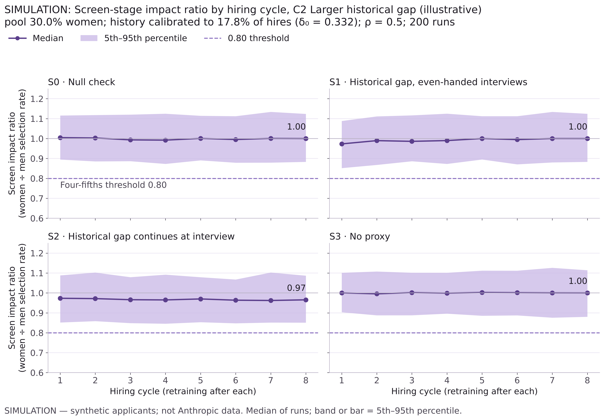
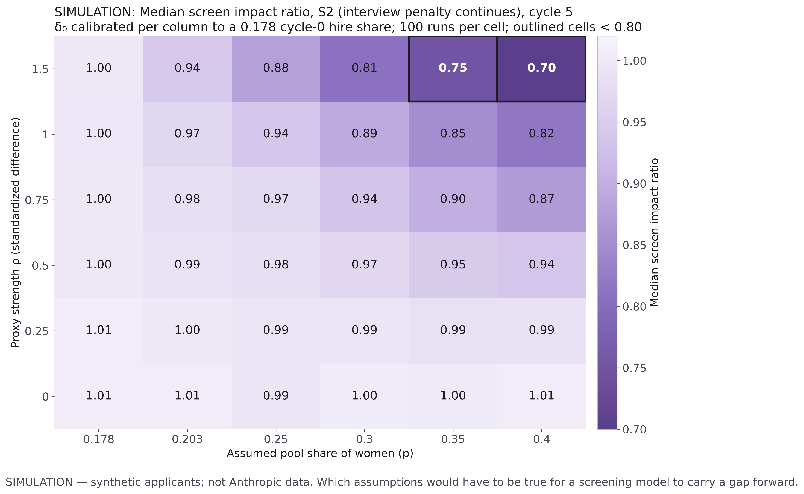
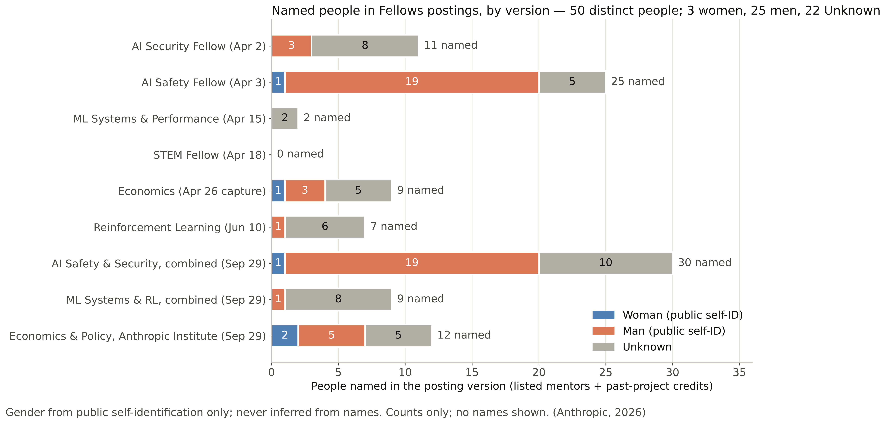

# Anthropic Greenhouse ATS AI Bias — Version C, with Version D models

## Version 3.0: Human-AI Employment Intelligence & Governance

This repository contains a controlled research and evidence architecture examining gender representation in an observed Anthropic hiring environment and measurement gaps across an AI-assisted employment system.

**Primary thesis question.** What is driving the observed gender disparity in Anthropic’s 2026 hiring environment, where might AI-assisted recruiting and human decision-making contribute to that disparity, and who should be responsible for identifying, measuring, and correcting potential systemic bias?

## Canonical observed outcome (Version C, frozen)

| Category | Count |
|---|---:|
| Male | 606 |
| Female | 276 |
| Unknown | 213 |
| Total | 1,095 |

Known-sex composition is 68.7% Male and 31.3% Female; the observed Male/Female ratio is 2.20:1. Unknown records remain Unknown. Observed starts April–July 2026 (Dewey & People Data Labs, 2026).

| Group (observed starts) | Male | Female | Unknown | Women among known sex |
|---|---:|---:|---:|---:|
| All hires | 606 | 276 | 213 | 31.3% (Wilson 95% CI 28.3–34.4%) |
| AI researchers (title-based) | 19 | 8 | 13 | 29.6% (15.9–48.5%) |
| Fellows | 14 | 8 | 10 | 36.4% (19.7–57.0%) |
| Engineering (general/unspecified) | 235 | 51 | 72 | 17.8% (13.8–22.7%) |

Groups overlap (Fellows sit inside AI researchers and All hires) and are never summed. Engineering vs. all other known-sex hires: 17.8% vs. 37.8%, Fisher's exact p < .001. All 8 research-classified women are Fellows; Research Scientist titles are 0 of 5 women.

## Version D (October 2026): two models

Neither model uses Anthropic applicant data, because none is available. Each states what it can and cannot claim.

| | Model 1 — Posting-signal model | Model 2 — Screening feedback-loop simulation |
|---|---|---|
| Folder | [`version_d/model1_posting_signal/`](version_d/model1_posting_signal/) | [`version_d/model2_feedback_loop/`](version_d/model2_feedback_loop/) |
| Question | What do postings signal: gender-coded wording (T7) and who is named (T6)? | If a sex-blind screener is retrained on the outcomes it helped produce, does a historical gap persist, grow, or fade? |
| Data | Observed posting text (Greenhouse captures, April–September 2026) | **Synthetic applicants only**, calibrated to the observed 17.8% engineering share and the 20.3% BLS benchmark |
| Status | **Complete:** pre-registered, run on 1,226 postings, 10 of 10 tests passed, results file, model card, methods appendix, figures, dashboard strings | **Complete:** run, 11 of 11 tests passed, results file, model card, methods appendix, figures |
| Can claim | What postings signal, by role family | How the mechanism behaves under stated assumptions |
| Cannot claim | That wording or named people changed who applied or was hired | Anything about Anthropic's actual screening system, applicants, or workforce |

### Model 2 headline results (SIMULATION — synthetic applicants; not Anthropic data)

Median of 200 runs with the 5th–95th percentile range. Screen impact ratio = women's shortlist rate ÷ men's shortlist rate; 0.80 is the four-fifths reference.

| Scenario | Screen impact ratio, cycle 1 | Screen impact ratio, cycle 5 | Overall impact ratio, cycle 5 |
|---|---|---|---|
| C1 benchmark pool (20.3%), S2 interview penalty continues | 1.00 (0.87–1.12) | 0.99 (0.86–1.13) | 0.86 (0.62–1.10) |
| C2 illustrative pool (30%), S1 even-handed interviews | 0.97 (0.85–1.09) | 1.00 (0.90–1.11) | 0.99 (0.80–1.27) |
| C2 illustrative pool (30%), S2 interview penalty continues | 0.97 (0.85–1.09) | 0.97 (0.85–1.08) | 0.60 (0.43–0.80) |

- **Null checks held.** With no historical penalty (S0) or no sex-correlated proxy (S3), the screen impact ratio stayed between 0.99 and 1.01 in every cycle.
- **The screen carried a small part of the gap; the interview stage set whether it persisted.** With even-handed interviews the screen gap faded by cycle 5. With a continuing interview penalty it persisted, and the screener's weight on the proxy grew from −0.064 to −0.105. Most of the overall gap formed at the interview.
- **Mitigations.** Removing the proxy (I1) or reweighing training data (I2) restored screen parity (1.00) with no loss of screen validity; freezing the screener (I3) did not (0.97).
- **What it would take to cross 0.80 at the screen:** in the sensitivity grid, only a strong proxy (ρ = 1.5) combined with a large historical gap (pool share ≥ 35% vs. 17.8% of hires).
- **Implication for governance (RQ5).** Hire counts alone cannot show which stage carries a gap. Stage-level selection rates by sex can, and they exist only inside the hiring system.

Full results: [`model2_results.json`](version_d/model2_feedback_loop/outputs/model2_results.json) · [model card](version_d/model2_feedback_loop/outputs/model_card.md) · [methods appendix](version_d/model2_feedback_loop/outputs/methods_appendix.md).

### Model 1 headline results (OBSERVED MEASUREMENT — posting text; describes wording, not intent)

- **Visibility (H2).** Fellows postings are the only postings that name people. Of the 50 people they name, 28 have public self-identification: **3 women and 25 men** (women 10.7%, Wilson 95% CI 3.7–27.2%). That is below parity (exact binomial p < .001) and below women's 36.4% share of known-sex Fellows hires (Fisher's exact p = .042). With 22 people Unknown, the share of all named people could be anywhere from 6% to 50%.
- **Wording (H1): not supported.** On the raw lexicon, Fellows postings use *fewer* masculine-coded words than other postings (2.83 vs. 12.59 per 1,000; Holm p = .025), as do research-titled postings (Holm p = .001). After low-precision stems are removed, the differences are under 1 word per 1,000.
- **The lexicon is weakly valid in this technical text.** Only 21% of audited matches use a word in a trait sense ("lead", "analysis", "support" and "responsibilities" are mostly technical or task words), and agreement with blind sentence ratings is κ = 0.24, below the pre-set 0.40.
- **Outcome link (H3): not estimable** from public data (4 hire cells; 10 required). **Model 1b**, the applicant-level test, is validated on simulated data (96% CI coverage) and ready for internal applicant counts by posting.

Full results: [`model1_results.json`](version_d/model1_posting_signal/outputs/model1_results.json) · [model card](version_d/model1_posting_signal/outputs/model_card.md) · [methods appendix](version_d/model1_posting_signal/outputs/methods_appendix.md) · [pre-registration](version_d/model1_posting_signal/analysis_plan.md).

## Analytical status

| Layer | Status |
|---|---|
| Observed disparity | OBSERVABLE |
| Posting signals (Model 1) | OBSERVABLE: named people mostly men among known self-ID; wording lexicon weakly valid |
| Algorithmic causation | NOT ESTABLISHED |
| Prediction | NOT ESTIMABLE FROM PUBLIC DATA |
| Historical feedback loops | EXPLORATORY HYPOTHESIS (simulated in Model 2; not confirmed) |
| Internal governance need | EVIDENCE SUPPORTS FURTHER INVESTIGATION |

No candidate-level model was fit to observed data. The public evidence does not contain sufficient independent matched outcome cells or candidate-stage outcomes. No applicant denominators were manufactured.

## What would test the ATS directly

1. Applicant counts by sex at each stage (applied, screened, interviewed, offered, hired) per role family.
2. Four-fifths impact ratios at each stage, with significance tests (and the NYC Local Law 144 method if an automated tool scores candidates).
3. A counterfactual name-swap audit of any automated screening step.
4. Model 1b on applicant counts per posting: whether wording or named people change who applies.

## Methodological controls

- No sex inference; Unknown remains Unknown.
- No candidate-level Greenhouse-to-hire linkage.
- No synthetic candidates in observed data. Model 2's synthetic applicants appear only in the labeled simulation.
- No claim that Greenhouse caused the observed disparity.
- The research-classified subset is not added to the overall outcomes.
- Version C files and source data are unchanged by Version D.
- Person-level named-people codes and the posting text corpus stay out of GitHub (`.gitignore`).

The observed outcome disparity does not establish adverse impact or its cause. The package identifies evidence gaps and a proposed Human-AI Employment Intelligence & Governance function.

## Publication status

**HOLD / REVIEW REQUIRED.** Licensing, privacy, and source-permission reviews are required before public release. The local package has not been published.

Repository destination metadata: https://github.com/elizabethhannan/Anthropic_Greenhouse_ATS_AI_Biased

## References

Dewey & People Data Labs. (2026). *Observed Anthropic starts, April–July 2026* [Unpublished data set extract].

Gaucher, D., Friesen, J., & Kay, A. C. (2011). Evidence that gendered wording in job advertisements exists and sustains gender inequality. *Journal of Personality and Social Psychology, 101*(1), 109–128.

Kamiran, F., & Calders, T. (2012). Data preprocessing techniques for classification without discrimination. *Knowledge and Information Systems, 33*(1), 1–33.

Lakkaraju, H., Kleinberg, J., Leskovec, J., Ludwig, J., & Mullainathan, S. (2017). The selective labels problem: Evaluating algorithmic predictions in the presence of unobservables. In *Proceedings of the 23rd ACM SIGKDD International Conference on Knowledge Discovery and Data Mining* (pp. 275–284).

U.S. Bureau of Labor Statistics. (2026). *Employed persons by detailed occupation, sex, race, and Hispanic or Latino ethnicity* (Labor Force Statistics from the Current Population Survey, Table 11, 2025 annual averages). https://www.bls.gov/cps/cpsaat11.htm

Uniform Guidelines on Employee Selection Procedures, 29 C.F.R. § 1607.4(D) (1978).
