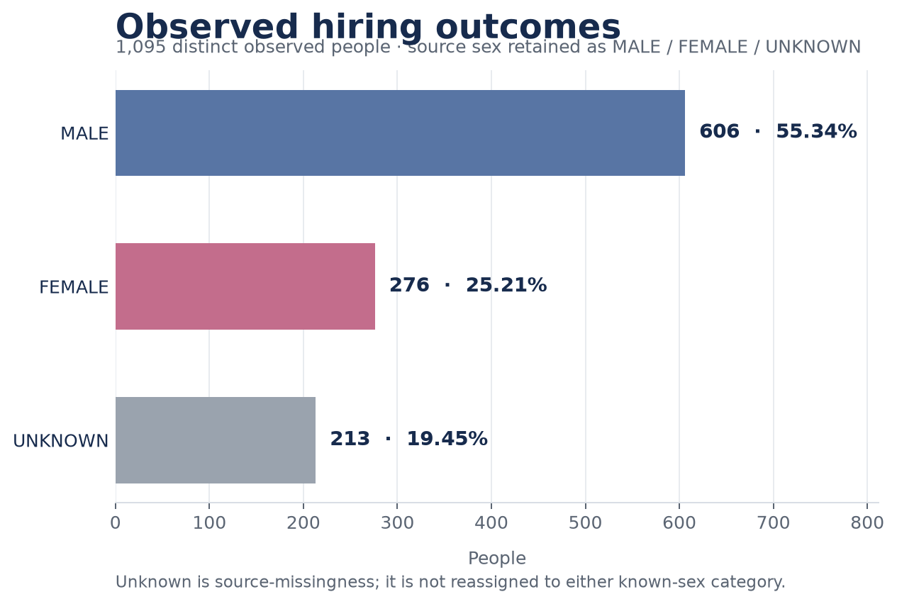
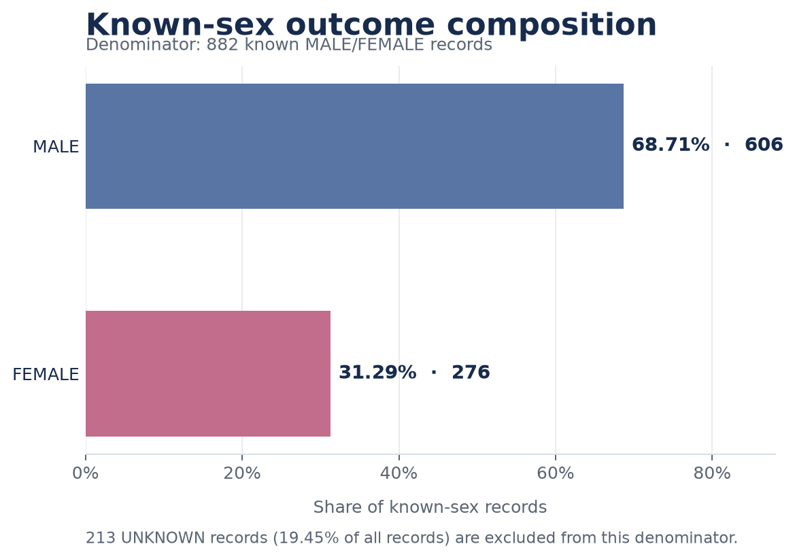
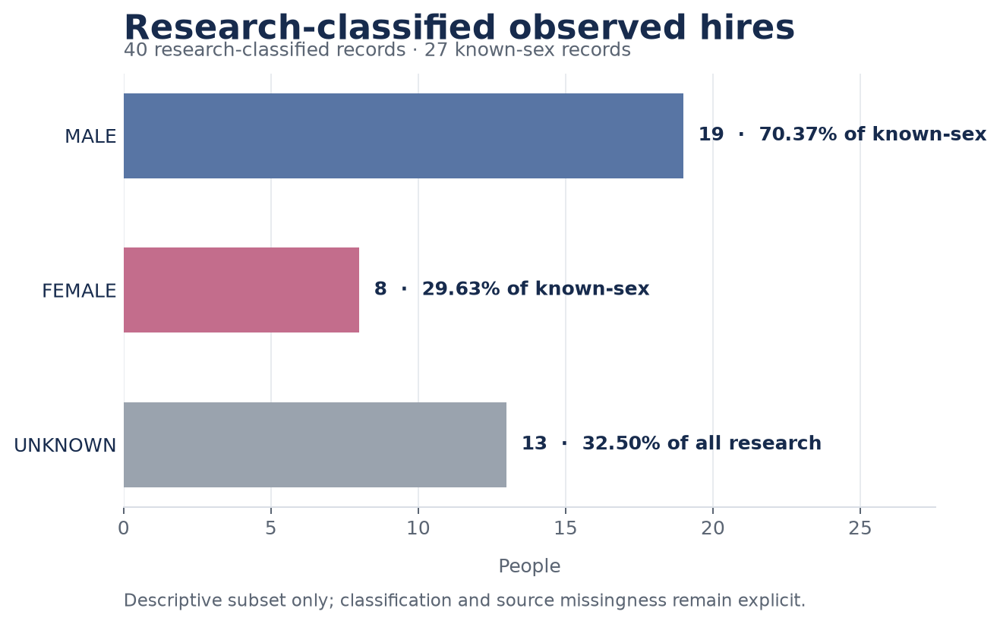
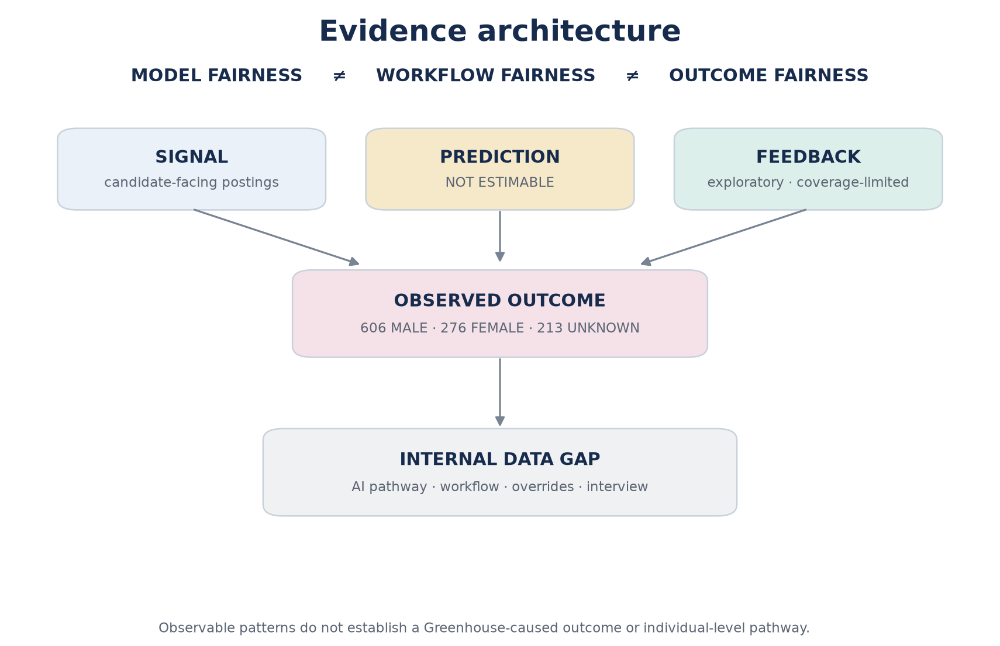
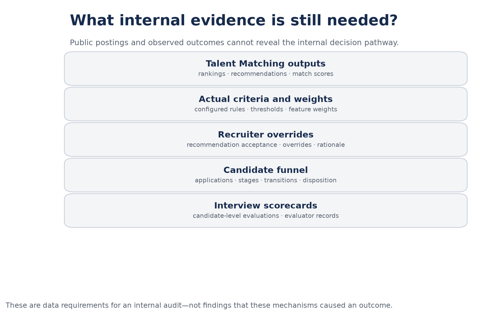
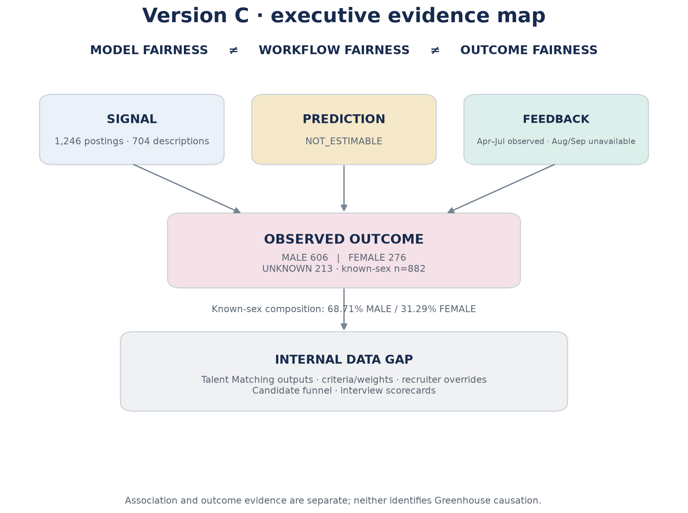

# Version C — Executive Research Brief

**Study window:** April 1–September 30, 2026  
**Evidence status:** Frozen Phase 7 dashboard and Phase 8 visualization package  
**Purpose:** Executive summary of observable evidence and documented auditability limits.

## Executive summary

Observed demographic outcome composition is measurable. Candidate-facing recruiting signals are measurable. Current role/month data are insufficient for the planned binary predictive model, and the available temporal comparisons are exploratory. Internal Greenhouse decision pathways are not publicly observable.

## Observed outcome composition

The frozen observed-hire records contain 606 MALE / 276 FEMALE / 213 UNKNOWN (N=1095). Among the 882 records with reported source sex, 68.71% are MALE and 31.29% are FEMALE, a 2.20:1 MALE/FEMALE ratio. The remaining 213 records (19.45% of all records) have no reported source sex and remain UNKNOWN.
These are descriptive counts from the observed dataset. They do not represent a complete candidate funnel and do not establish a Greenhouse effect.

## Candidate-facing signal evidence

Phase 3 measured features from the public Greenhouse corpus. The frozen dashboard reports 1246 posting records; 704 descriptions available.
This describes material visible in postings. The records do not link a specific posting to a specific hire.

## Prediction: not estimable

Phase 4 is NOT_ESTIMABLE. Only 3 exact role/month cells matched established-date postings with known-sex observed outcomes; 3 cells contain Male outcomes and 0 contain Female outcomes.
Only 3 exact role/month cells have both dated postings and known-sex observed hires (minimum 20); cells containing Male outcomes=3, Female outcomes=0 (minimum 5 each). Grouped cross-validation is not estimable.

## Feedback: exploratory with coverage limits

Phase 5 status is COMPLETE_WITH_COVERAGE_LIMITS. It reports 5 exact role/month overlaps. Observed hire-start months are 2026-04, 2026-05, 2026-06, 2026-07; August and September 2026 are unavailable in this snapshot, not zero.
The forward comparisons have few month pairs; the +2 month analysis is deferred. Any co-movement remains exploratory and ecological, not causal.

## Internal evidence required

Public postings and aggregate observed outcomes do not expose the internal decision pathway. An internal audit would require Talent Matching outputs, actual criteria and weights, recruiter override records, applicant-stage progression, and interview scorecards.
The absence of these records means the internal Greenhouse pathway is unobservable in this public-data project. It is not evidence that any one mechanism caused the observed outcome composition.

## Executive interpretation

An observed disparity is evidence of an outcome pattern. A predictive association, if estimable, would show information in observable signals. Neither alone demonstrates that Greenhouse AI caused an outcome. Here, the planned predictive model is not estimable with the matched role/month evidence.
MODEL FAIRNESS ≠ WORKFLOW FAIRNESS ≠ OUTCOME FAIRNESS

## Evidence status at a glance

| Layer | Status | What it supports |
| --- | --- | --- |
| SIGNAL | Observable / descriptive | Measures candidate-facing posting text and representation. |
| PREDICTION | NOT_ESTIMABLE | Matched role/month sample does not support the planned grouped model. |
| FEEDBACK | Exploratory / coverage-limited | Aggregate temporal and role/month co-movement only. |
| OUTCOME | Observable with missingness | 606 MALE / 276 FEMALE / 213 UNKNOWN; UNKNOWN is retained. |
| INTERNAL WORKFLOW | Data gap | Talent Matching, recruiter, funnel, and interview records are unavailable. |

## Frozen visuals

### Observed MALE / FEMALE / UNKNOWN outcome counts.

### Known-sex composition; UNKNOWN is excluded from the denominator.

### Research-classified observed outcomes; source missingness remains separate.

### The observable signal, prediction, feedback, outcome, and internal-data-gap layers.

### Internal data required to examine the recruiting decision pathway.

### Version C executive evidence map; no causal pathway is asserted.

## Provenance and boundaries

Phase 7 validation: PASS (23 checks; 0 failures).  
Phase 8 visualization package: PASS.  
No individual hire is linked to a Greenhouse posting. Unknown source sex is not imputed. Archive captures are not treated as posting dates. August/September outcome coverage is unavailable, not zero. No causal Greenhouse claim is made.
